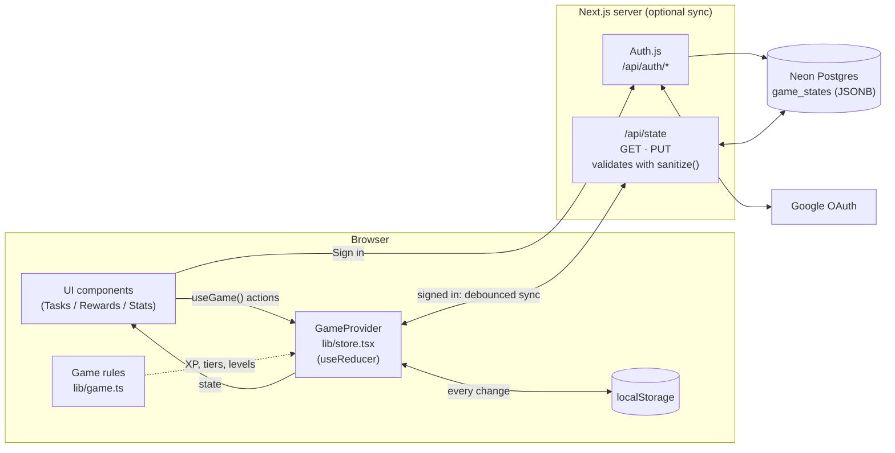

# Battlepass

A to-do list that works like a game. Finishing a task earns XP and coins. XP moves you up a monthly battle pass and a lifetime account level. Coins buy rewards that you set yourself.

Built with Next.js 15 (App Router), React 19, TypeScript and Tailwind CSS v4. Sign-in and cloud sync are optional and use Auth.js (Google), Drizzle ORM and Neon Postgres.

## How it works

### Tasks

Each task has a difficulty. Harder tasks pay more:

| Difficulty | Battle-pass XP | Account XP | Coins |
| ---------- | -------------: | ---------: | ----: |
| Easy       | 10             | 3          | 5     |
| Medium     | 30             | 10         | 20    |
| Hard       | 90             | 30         | 75    |

- **One-off tasks** are checked off once.
- **Repeatable tasks** stay open. Every completion pays again and adds 1 to a counter that resets each season.
- You can pin tasks to the top of the list and clear all completed tasks at once.

### Two kinds of progress

- **Battle pass (monthly season).** 15 tiers, 280 XP per tier. A season is one calendar month, and pass XP resets on the 1st. If you do 2 easy, 1 medium and 1 hard task a day (140 XP), you finish the pass in about 28 days. Finished passes are counted for good.
- **Account level (lifetime).** Never resets. It gets about a third of the XP the pass gets and follows a steeper curve (`100 × 1.32^(level−1)` XP per level), so it rises slowly.

There is also a **daily streak**: the number of days in a row on which you finished at least one task.

### Rewards

Coins are spent in the Rewards tab. It starts with a sample list (coffee break, movie night, a day off, …). You can add your own rewards with your own prices and delete any of them.

### Tabs

- **Tasks:** add, complete, pin and delete tasks.
- **Rewards:** spend coins and manage your reward list.
- **Stats:** tier track for the current season, completion counts and streak.

All game numbers are in [`lib/game.ts`](lib/game.ts). Change that file to rebalance the game.

## Architecture



- **The client owns the game.** The whole game is one `GameState` object, managed by a reducer in `lib/store.tsx`. Components read and change it only through the `useGame()` hook. The three tabs are switched with React state, not routes, so the app has a single page (`/`).
- **Saving locally comes first.** State is written to `localStorage` on every change, so the app works fully without an account.
- **Cloud sync is opt-in.** After Google sign-in, the client loads the saved state from `/api/state`. If the server has a copy, that copy is used. If the server is empty, any local progress is uploaded. After that, changes are sent to the server with a short delay (debounced). The state is stored as one JSONB row per user.
- **`sanitize()`** (`lib/state.ts`) checks and normalizes all saved state, whether it comes from `localStorage` or from a request body, and fills in fields missing from older saves.

### Project layout

```
app/
  page.tsx                  # app shell + tab switch
  api/state/route.ts        # load/save the signed-in user's state
  api/auth/[...nextauth]/   # Auth.js routes
components/                 # TopBar, TabBar, HomeTab, RewardsTab, StatsTab, …
lib/
  store.tsx                 # GameProvider, reducer, sync logic
  game.ts                   # tuning: XP, coins, curves, seed data
  season.ts                 # monthly-season and streak date helpers
  state.ts                  # sanitize() + storage key
  state-repository.ts       # localStorage / API load & save
  db/                       # Drizzle schema, client, migrations
auth.ts                     # Auth.js config (Google provider)
```

## Getting started

```bash
npm install
cp .env.example .env.local   # then fill in the values (see below)
npm run dev                  # http://localhost:3000
```

### Environment variables

| Variable             | Purpose |
| -------------------- | ------- |
| `AUTH_SECRET`        | Encrypts Auth.js sessions. Generate one with `npx auth secret`. |
| `AUTH_GOOGLE_ID`     | Google OAuth client ID |
| `AUTH_GOOGLE_SECRET` | Google OAuth client secret |
| `DATABASE_URL`       | Neon Postgres pooled connection string |

For Google OAuth, create a "Web application" OAuth client in the Google Cloud Console and add `http://localhost:3000/api/auth/callback/google` as an authorized redirect URI.

Create the database tables:

```bash
npm run db:migrate
```

### Scripts

| Command               | Description |
| --------------------- | ----------- |
| `npm run dev`         | Start the dev server |
| `npm run build`       | Production build (also type-checks and lints) |
| `npm run start`       | Serve the production build |
| `npm run lint`        | Run ESLint |
| `npm run db:generate` | Generate a migration from `lib/db/schema.ts` |
| `npm run db:migrate`  | Apply migrations |
| `npm run db:studio`   | Open Drizzle Studio |

## License

[MIT](LICENSE)
